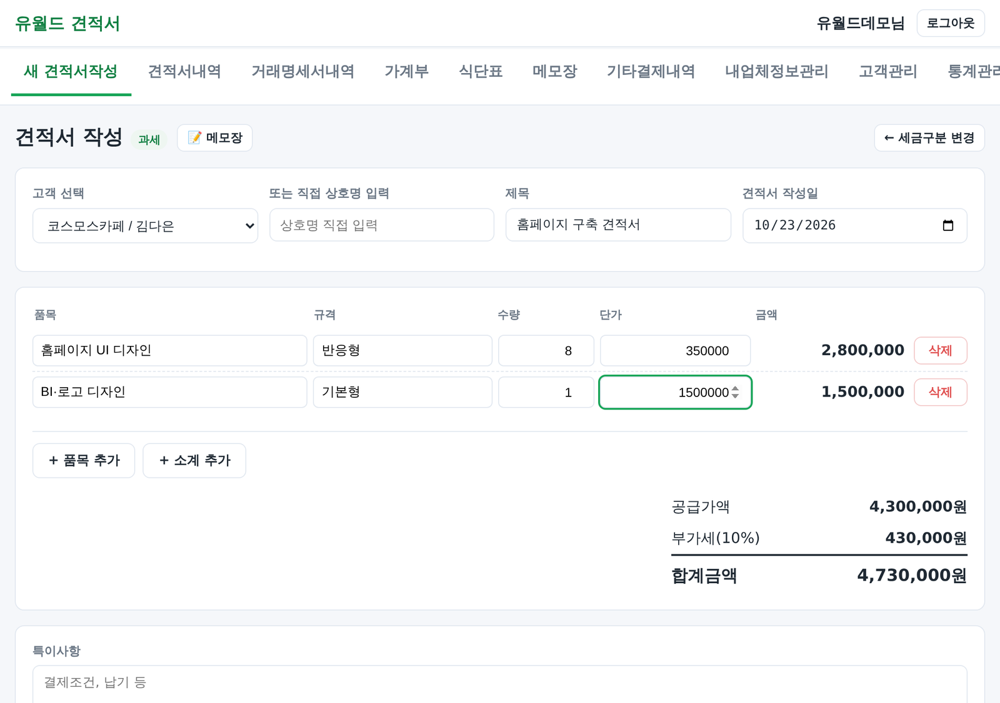
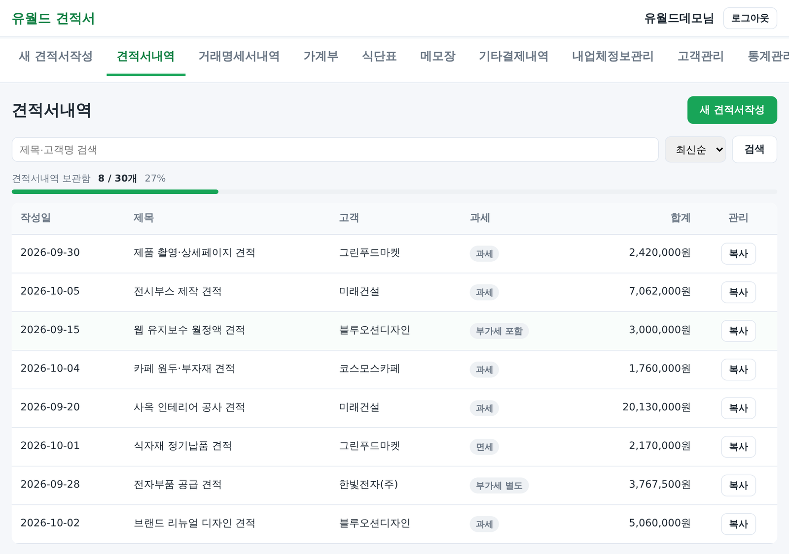
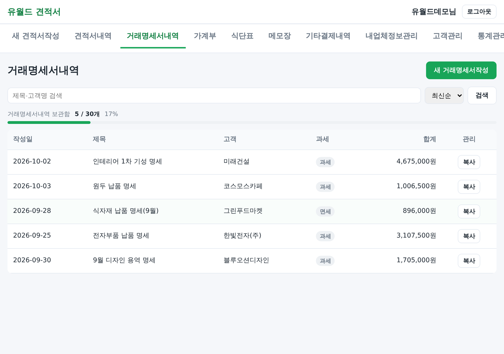
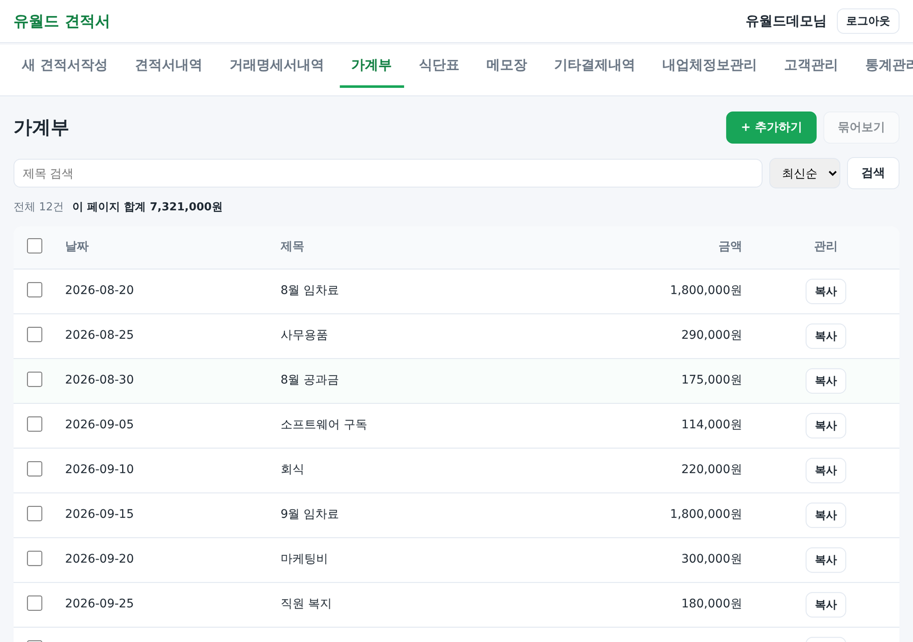
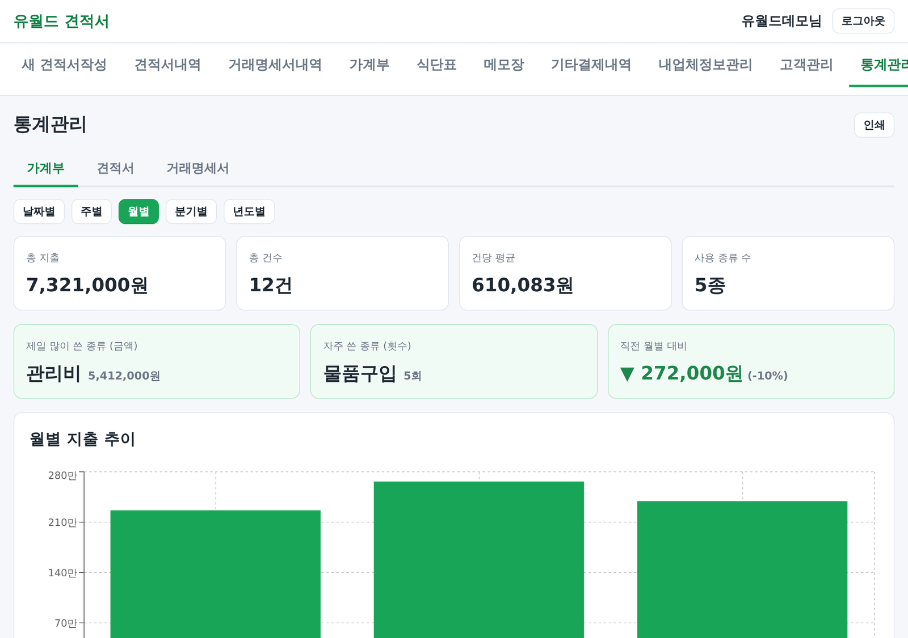
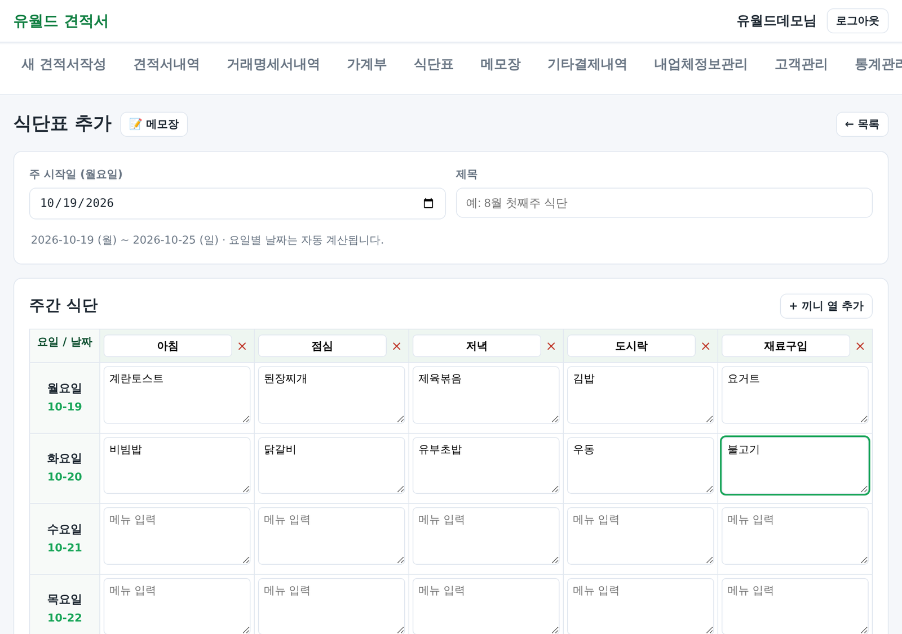

<div align="center">

# UWorld Quotation · 유월드 견적서

**Quotes, statements and everyday business paperwork in one minute — free.**
**견적서·거래명세서부터 가계부까지, 1분이면 끝나는 무료 업무 문서 앱.**

[](https://github.com/UWorld-Group/uworldquotation/releases/latest)
[](https://github.com/UWorld-Group/uworldquotation/releases)

| Web | Windows | macOS | Android | iPhone · iPad |
|:---:|:---:|:---:|:---:|:---:|
| [**Open**](https://quot.uworld.co.kr) | [**Download**](https://github.com/UWorld-Group/uworldquotation/releases/latest) | [**DMG**](https://github.com/UWorld-Group/uworldquotation/releases/latest) · [Mac App Store](https://apps.apple.com/app/id6814092018) | [Google Play](https://play.google.com/store/apps/details?id=kr.co.uworld.quotation) | [App Store](https://apps.apple.com/app/id6814092018) |

</div>

## Screenshots · 화면

<p align="center">
  
  
</p>
<p align="center">
  
  
</p>
<p align="center">
  
  
</p>

---

## Why UWorld Quotation · 왜 유월드 견적서인가

Small businesses and freelancers in Korea still spend too much time on spreadsheets just to send a quote or a transaction statement. UWorld Quotation removes the forms: pick a client, type your items, and the totals, VAT and a clean, print-ready document are done for you.

Everything you write is saved to your account, so the same quotes, clients and items are available on the web, on your PC or Mac, and on your phone. Beyond quotes, it keeps the small things a business owner tracks every day — a ledger, memos, even a weekly meal plan — in the same place.

소상공인과 프리랜서가 견적서 한 장, 거래명세서 한 장을 보내려고 엑셀 양식과 씨름하는 시간을 없애기 위해 만들었습니다. 고객을 고르고 품목만 입력하면 금액·부가세 계산과 인쇄용 문서가 자동으로 완성됩니다.

작성한 내용은 계정에 저장되어 웹·PC·Mac·휴대폰 어디서나 같은 견적서와 고객·품목을 이어서 쓸 수 있습니다. 견적서뿐 아니라 가계부·메모장·식단표처럼 매일 챙기는 업무 기록도 한곳에서 관리합니다.

## Features · 주요 기능

### 📝 Quotes in a minute · 1분 견적서
- Choose a client, add items and quantities — supply amount, VAT (10%) and total are calculated instantly.
  고객을 고르고 품목·수량만 입력하면 공급가액·부가세(10%)·합계가 바로 계산됩니다.
- Taxable, VAT-included and tax-free modes, subtotals, and notes such as payment terms.
  과세·부가세 포함·면세 구분, 소계, 결제조건 같은 특이사항을 지원합니다.

### 📄 Transaction statements & other payments · 거래명세서·기타결제
- Turn a quote into a transaction statement with one click, or write one from scratch.
  견적서를 거래명세서로 한 번에 전환하거나 새로 작성합니다.
- Keep other payment records alongside your quotes and statements.
  기타 결제 내역도 함께 기록합니다.

### 🖨️ PDF, print and share · PDF·인쇄·공유
- Save any document as a clean PDF, print it, or copy and share it.
  모든 문서를 깔끔한 PDF로 저장하고, 인쇄하고, 복사·공유할 수 있습니다.

### 👥 Clients, items and your company info · 고객·품목·내 업체 정보
- Save clients and your own business details once and reuse them in every document.
  고객과 내 업체 정보를 한 번 저장해 두면 모든 문서에 다시 씁니다.

### 📊 Statistics & sales management · 통계·영업관리
- Daily, weekly, monthly, quarterly and yearly statistics with charts.
  일·주·월·분기·연도별 통계를 차트로 봅니다.
- Rule-based sales management helps you follow up with clients on time.
  규칙 기반 영업관리로 고객 후속 연락 시점을 놓치지 않게 도와줍니다.

### 💰 Ledger · 가계부
- Record expenses by item, see totals and trends, and group entries to review them together.
  지출을 품목별로 기록하고 합계·추이를 확인하며, 여러 건을 묶어서 봅니다.

### 🍱 Weekly meal plan & memos · 식단표·메모장
- A weekly meal-plan grid (7 days × meals) with landscape PDF output, and a card-style notepad.
  요일×끼니 주간 식단표(가로 PDF 출력)와 카드형 메모장을 제공합니다.

### 🔄 One account, every device · 하나의 계정, 모든 기기
- Sign in once with auto-login and pick up where you left off on the web, desktop or mobile.
  자동 로그인으로 한 번만 로그인하면 웹·데스크톱·모바일에서 이어서 작업합니다.

---

## Install · 설치 안내

### Windows

**Requirements · 사양**: Windows 10 / 11 (64-bit), internet connection. Microsoft Edge WebView2 (included in Windows 11; installed automatically if missing).

1. Download **`UWorldQuotation-<version>-windows-x64-setup.exe`** from the [latest release](https://github.com/UWorld-Group/uworldquotation/releases/latest).
   [최신 릴리스](https://github.com/UWorld-Group/uworldquotation/releases/latest)에서 설치 파일을 내려받습니다.
2. Run it and follow the installer. The installer is code-signed by **유월드 (UWorld)**.
   실행하면 설치가 진행됩니다. 설치 파일은 "유월드" 이름으로 서명되어 있습니다.
3. *(Optional)* Verify the file with `SHA256SUMS.txt` from the same release:
   *(선택)* 같은 릴리스의 `SHA256SUMS.txt` 로 파일이 변조되지 않았는지 확인할 수 있습니다.
   ```powershell
   Get-FileHash .\UWorldQuotation-<version>-windows-x64-setup.exe -Algorithm SHA256
   ```

### macOS (DMG)

**Requirements · 사양**: macOS 12 or later, Apple silicon or Intel (universal app), internet connection.

1. Download **`UWorldQuotation-<version>-macos-universal.dmg`** from the [latest release](https://github.com/UWorld-Group/uworldquotation/releases/latest) and open it.
   최신 릴리스에서 DMG를 내려받아 엽니다.
2. Drag **유월드 견적서** onto **Applications**. The app is signed with UWorld's Developer ID and **notarized by Apple**.
   **유월드 견적서**를 응용 프로그램 폴더로 끌어다 놓습니다. 유월드 Developer ID 서명과 Apple 공증을 받은 앱입니다.
3. Prefer automatic updates? Install from the [Mac App Store](https://apps.apple.com/app/id6814092018).
   자동 업데이트를 원하시면 Mac App Store판을 설치하세요.
   ```bash
   shasum -a 256 UWorldQuotation-<version>-macos-universal.dmg
   ```

### Web & mobile · 웹·모바일

- Web · 웹: https://quot.uworld.co.kr — no installation needed. 설치 없이 바로 사용합니다.
- Android: [Google Play](https://play.google.com/store/apps/details?id=kr.co.uworld.quotation) · iPhone / iPad: [App Store](https://apps.apple.com/app/id6814092018)

---

## About this repository · 이 저장소에 대해

This repository is used **only to distribute installers**. The source code is not published here.
The "Source code" archives that GitHub attaches to every release contain only this README, the license and the screenshots.

이 저장소는 **설치 파일 배포 전용**입니다. 앱 소스코드는 공개하지 않으며, 릴리스마다 GitHub가 자동으로 붙이는 "Source code" 압축 파일에는 이 안내문·사용권 안내·화면 이미지만 들어 있습니다.

## Support · 문의

- Website · 웹사이트: https://service.uworld.co.kr

<div align="center">

Part of **[UWorld Group](https://github.com/UWorld-Group)** · See [LICENSE.txt](LICENSE.txt) · © UWorld. All rights reserved.

</div>
